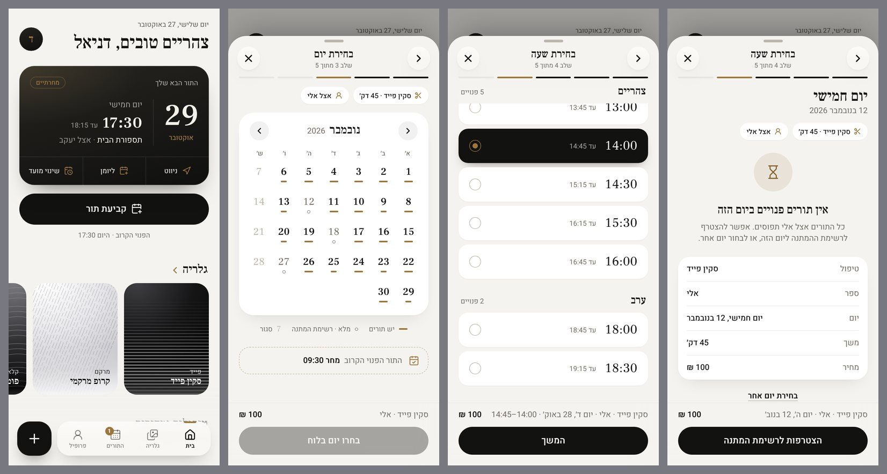
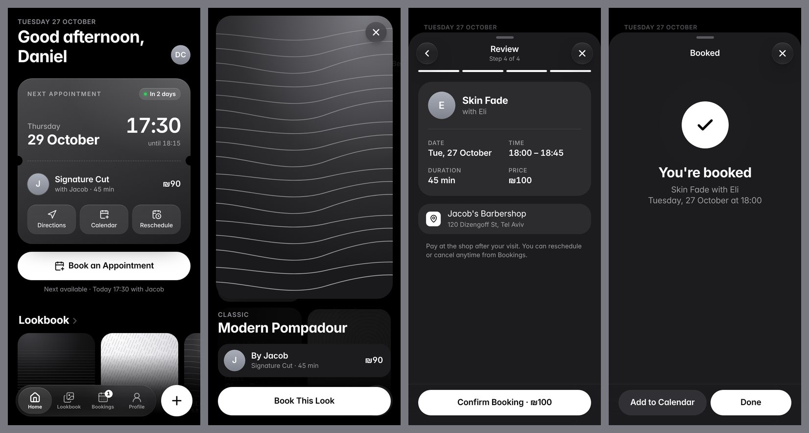

# JACOB'S — Barbershop Booking App

A premium booking app for JACOB'S barbershop, in Hebrew (RTL): native-feeling on phones, with its own layout on tablets and desktops. It has its own identity: warm monochrome neutrals, ink surfaces, and a single brass accent. Display type is Frank Ruhl Libre (titles and numerals); UI text is Heebo.




## Run it

```bash
npm install
npm run dev
```

The app is served under `/JACOBSBARBERSHOPNISYONI/` (the GitHub Pages path) in development too, so open the URL Vite prints, e.g. `http://localhost:5173/JACOBSBARBERSHOPNISYONI/`. To try it on your phone, run `npm run dev -- --host` and open the network URL on the same Wi-Fi. In Safari, **Share → Add to Home Screen** installs it full-screen with its own icon.

```bash
npm run build     # type-check + production build to dist/
npm run lint      # oxlint
```

## Admin (staff)

A staff management system lives at **`/admin/`**: dashboard, calendar (day, week, month), appointments, waiting lists, team, services, customers and settings, for desktop and iPhone. It needs a Supabase backend; until one is configured, production shows a setup notice, and `npm run dev` runs a clearly labelled in-memory prototype. Architecture, security model and the exact setup steps are in **[docs/admin.md](docs/admin.md)**.

```bash
npm test          # unit tests
npm run test:db   # database tests (disposable Postgres 16)
```

## Deployment

**Live site:** https://link-page.github.io/JACOBSBARBERSHOPNISYONI/

- **Production branch: `main`.** Every push to `main` runs `.github/workflows/deploy.yml`.
- **What the workflow does:** installs dependencies, lints, builds, and publishes `dist/` to GitHub Pages. A failed build never replaces the live site.
- **Re-deploy without a code change:** Actions → *Deploy to GitHub Pages* → *Run workflow*.
- **Base path:** set once in `vite.config.ts` (`base`). Files in `public/` must be referenced through `publicUrl()` (`src/lib/public-url.ts`) so they resolve under that path.
- **Required repository setting:** Settings → Pages → *Build and deployment* → Source: **GitHub Actions**.

## What's inside

| Tab | What it does |
| --- | --- |
| **בית (Home)** | Greeting and the notification bell; next-appointment card with the booked barber's photo, attendance confirmation (*אישור הגעה*) and actions (directions, add to calendar, reschedule — or WhatsApp once attendance is confirmed); booking button with the next free slot, gallery and team as centre-focused carousels, services and prices, hours and map. |
| **גלריה (Gallery)** | The shop's real photos (Supabase Storage), filterable by category; tap one to open it full-screen and book that style. An honest empty state until photos are uploaded. |
| **התורים (Bookings)** | Upcoming and history: confirm attendance, reschedule, cancel (with confirmation), add to calendar, rebook. A confirmed appointment is changed through the shop (WhatsApp). |
| **פרופיל (Profile)** | Name, phone, visits, favourite barber, appearance (automatic / light / dark), notification preferences (push on this device, reminders, messages from the shop), contact links, and sign-out. |

### Booking flow

A sheet with five steps: **service → barber → day → time → summary**. Selections are kept when moving back and forth.

- **Day: full-month calendar** (Sunday-first, RTL). Navigate with the arrows or by swiping between months. Each day shows its state:
  - brass bar: appointments available (longer bar = more free slots)
  - hollow ring: fully booked, but still tappable for the waiting list
  - faded number: closed, past, or beyond the 60-day booking window (not tappable)
- **Time: separate screen.** Tapping a day opens a vertical list of large time rows grouped into morning, afternoon and evening, with sticky group headers and a fixed Continue button.
- **Waiting list.** A fully booked day opens the same time screen with an empty state and a **הצטרפות לרשימת המתנה** button. It registers the date, barber and service, then shows a confirmation; joining twice reports that you're already on the list.

## Accounts and data

With the Supabase variables set, customers sign in or register (email and password, name and Israeli mobile, email confirmation), and everything they see and book comes from the database: services, the real team and their photos, the gallery, their own appointments and waiting-list requests. Without them, the app runs as an on-device demo that says so on every confirmation. Details, security model and the Supabase settings needed before opening registration: **[docs/customer-app.md](docs/customer-app.md)**.

## Notifications and attendance confirmation

An in-app notification centre plus Web Push on Android, desktop and iPhone (from the Home Screen). Attendance is confirmed the day before, and unconfirmed appointments are cancelled automatically at the deadline. Everyone waiting for a day is told when time frees up, and the first to book gets it. A reminder goes out about two hours before a confirmed appointment, and the admin can send messages to customers. Rules, architecture, tests, and the owner's setup steps (migrations 0011–0016, VAPID keys, the push Edge Function, pg_cron): **[docs/notifications.md](docs/notifications.md)**.

## Architecture

See [docs/customer-app.md](docs/customer-app.md#architecture) for the customer app's modules and [docs/admin.md](docs/admin.md#architecture) for the admin. In short: screens depend on contracts (`AccountApi`, `CatalogueApi`, `BookingApi`); `src/backend/index.ts` picks the Supabase or on-device implementation once; pure domain logic lives in `src/booking/` and is shared with the admin.

## Stack

React 19, TypeScript, Vite, Tailwind CSS v4, shadcn/ui (Button, Drawer/vaul, Avatar, Switch), Motion (lazy-loaded with `LazyMotion`), Lucide icons.

Motion is used for spring selection indicators (calendar day, time row, tabs), direction-aware step and month transitions, and the confirmation emblem. `prefers-reduced-motion` is respected throughout.

## Before launch

- **Contact details**: address, phone, WhatsApp, Instagram and hours in `src/data/shop.ts` are placeholders.
- **Photos**: upload barber portraits (Team) and gallery photos (Settings → Gallery) in the admin; the app shows them from Supabase Storage.
- **Registration**: follow [docs/customer-app.md → Before opening registration](docs/customer-app.md#before-opening-registration-supabase-settings).
- **Notifications**: install migrations 0011–0016 **before** publishing this version, then follow [docs/notifications.md → External setup](docs/notifications.md#external-setup-owner-step-by-step).
